# 집.착

<p align="center">
  
</p>

> **내 맘에 착, 내 삶에 착.**
>
> 대화로 조건을 정하고, 지도에서 동네를 비교하고, 추천 이유를 근거로 확인합니다.

집.착은 예산·직장·생활 취향을 대화로 받아 서울의 거주 후보 동네를 찾아주는 **Streamlit 지도·RAG 프로젝트**입니다. ‘내 마음에 착 맞는 집’과 ‘집을 꼼꼼하게 따져본다’는 뜻을 이름에 담았습니다.

가격을 비교하는 데서 끝나지 않고, **왜 이 동네가 후보인지, 어떤 자료를 확인했고 무엇은 아직 모르는지** 설명하는 것을 목표로 만들었습니다. 현재는 공식 전월세 **과거 거래**와 대표점의 생활환경을 비교합니다. 실시간 매물 중개나 개별 주택의 계약 가능성을 확인하는 서비스는 아닙니다.

**검증 기준일: 2026-10-23** · 서울 법정동 메타데이터 **467개** · 따릉이 위치 **2,789개** · 주요 공원 위치 **132개** · 자동 위키 문서 확장 **5개 동네** · Python 테스트 **166개 통과**

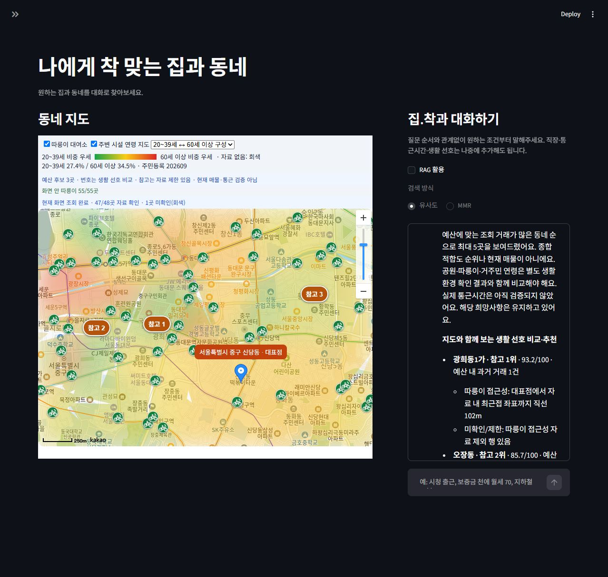

*실제 브라우저 검증 화면입니다. 지도·대화를 메인에 두고 수동 설정·조회·검증은 접힌 사이드바에 모았습니다. 일부 화면은 Top-k 추가 전 촬영본이며 최신 설정은 아래에 별도로 표시합니다.*

## 왜 만들었나

집을 찾을 때는 부동산 가격, 공원, 자전거 대여소, 동네 인구 구성, 출근 경로를 서로 다른 화면에서 확인하게 됩니다. 조건을 하나 바꾸면 같은 과정을 다시 반복합니다. 집.착은 이 비교를 하나의 지도와 대화로 이어보려는 시도입니다.

> “보증금 천에 월세 70까지 찾아줘.”
>
> “월세만 60으로 낮춰줘.”
>
> “공원보다 따릉이 접근성을 더 중요하게 봐줘.”
>
> “이 동네가 추천된 근거는 뭐야?”

사용자는 정해진 질문 순서에 맞춰 모든 항목에 답할 필요가 없습니다. 말한 조건을 누적하고 바뀐 조건만 수정합니다. 거래 조회에는 자치구·계약월·주택 유형과 예산이 필요하며, 부족한 범위를 확인한 뒤 조회합니다. 직장이나 통근시간만으로 조회 지역을 임의로 정하지 않습니다.

## 어떤 기능이 있나

| 기능 | 현재 동작 | 해석 범위 |
| --- | --- | --- |
| 대화로 조건 수집·수정 | 직장·예산·조회 지역·기간·유형·생활 선호를 누적하고 변경분 반영 | 미입력 조건을 AI가 사실처럼 채우지 않음 |
| 공식 전월세 거래 탐색 | 아파트·연립다세대·단독다가구·오피스텔 API 조회, 예산 필터 | 과거 계약 자료이며 현재 호가·빈집 목록 아님. 매매는 미구현 |
| 추천 후보와 지도 핀 | 같은 계산 결과로 답변 순서·번호 핀 갱신, 클릭하면 근거 패널 | 위치 확인된 동네 대표점. 개별 건물·호실 좌표 아님 |
| 생활 선호 비교 | 공원·따릉이 직선거리와 희망 주민 연령 비율을 가중 비교 | 결측값을0으로 채우지 않으며 자료 제한은 참고 순위로 표시 |
| 연령 지도·대여소 레이어 | 화면 범위의 법정동 주민등록 자료 자동 조회, 부드러운 색상 연결, 초록 자전거 아이콘 | 회색은 미확인. 색을 부드럽게 그린 것이 건물별 인구 추정을 뜻하지 않음 |
| 통합 동네 카드 | 예산 내 과거 거래·시설·주민등록 구성·원문 출처 표시 | 시설은 기준점500m 직선거리, 실제 보행 접근성과 구분 |
| RAG 근거 답변 | RAG 켜기/끄기, 유사도/MMR, Top-k1~20, 검색·인용 문서 구분·JSON 저장 | RAG 해제 시 조건 대화이며 아래 실험의 독립 no-RAG 답변과 다름 |
| 통근 확인 | 공식 카카오맵 대중교통·도보·자전거·차량 길찾기 연결, 사용자 확인 시간 기록 | 제휴 API 미사용. 앱이 경로시간을 자동 수신·검증하지 않음 |
| 서울 현재환경 수동 비교 | 인구·주차·지하철·충전소·대기·상권 파싱/화면·비교 구현 | 서울8088 연결 시간 초과가 있어 실제 서비스 연결 검증은 남음 |

### 조건을 바꾸면 지도와 후보가 함께 바뀝니다

개발 검증용으로 **중구·2026년9월·오피스텔·보증금1,000만원**을 고정했습니다. 월세 상한70만원에서는12건·6동네, 60만원에서는3건·3동네가 남았습니다. 저장한 조회 결과를 재사용해 예산 필터를 다시 적용했습니다.

| 변경 | 실제 확인 결과 |
| --- | --- |
| 월세70→60만원 | 예산 내 과거 거래12→3건, 후보6→3동네 |
| 공원 중요도5→0, 따릉이0→5 | 광희동1가 점수77.0→93.2점, 가까운 대여소 직선102m |
| 선호 변경 후 순서 | 이 사례에서는 점수는 바뀌었으나 후보 순서는 유지됨 |

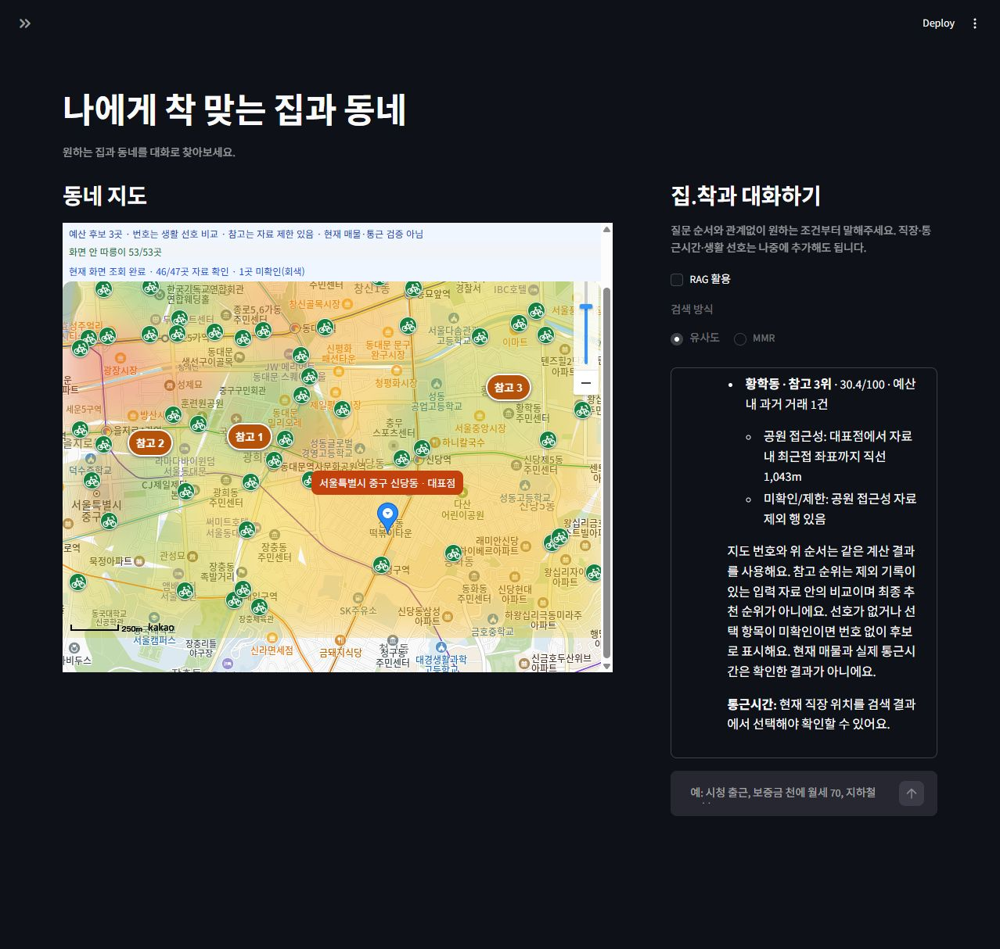

[실제 조건 변경 기록](docs/검증/대화추천_연결결과.json). 이 조건은 개발 시나리오이며 사용자의 실제 주거 조건이 아닙니다. 원자료 제외 기록이 있어 화면 번호는 **참고 순위**입니다.

### 후보를 클릭해 근거를 확인합니다

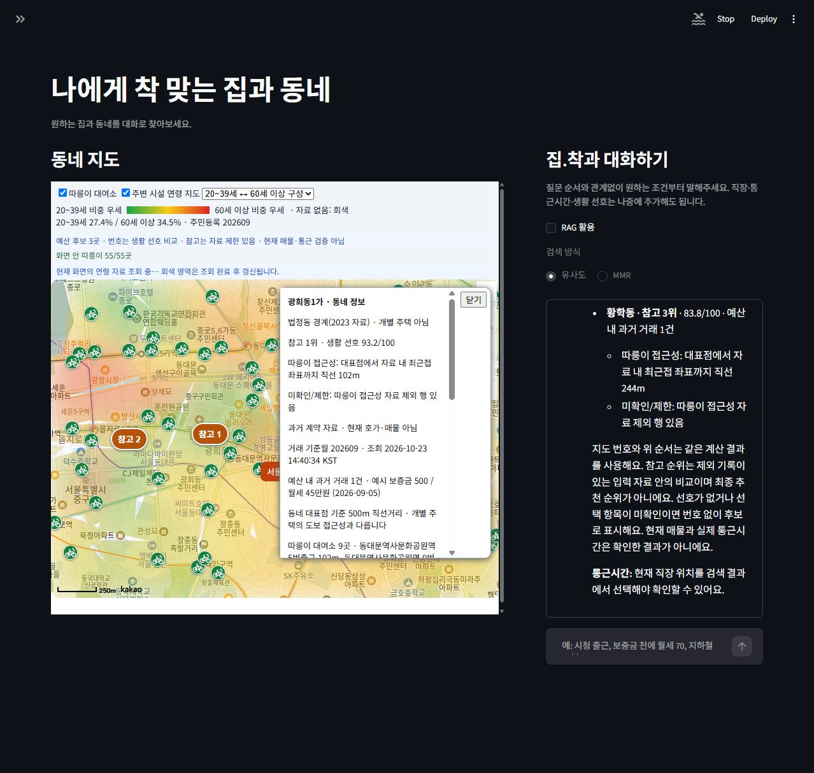

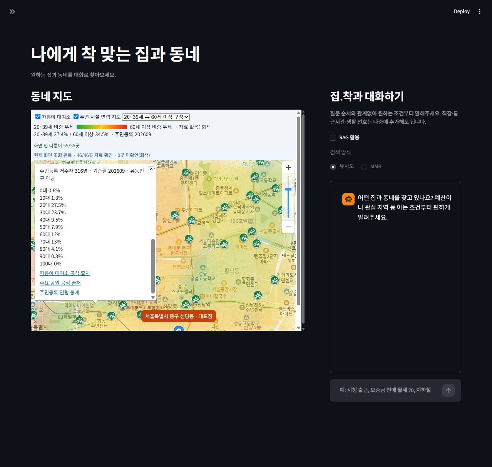

주민등록 거주자 통계와 실시간 생활인구는 별개의 자료로 다룹니다. 대표점에 연결된 공원·대여소 거리도 개별 주택의 거리처럼 설명하지 않습니다.

### 지도 이동에 맞춰 필요한 자료를 가져옵니다

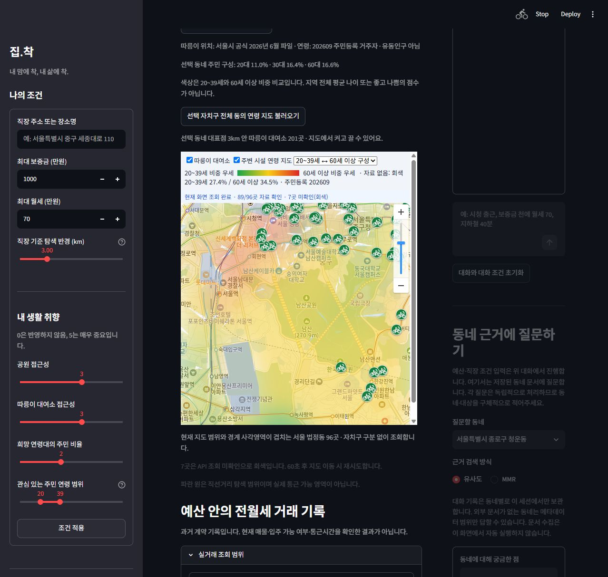

화면과 겹치는 동을 찾아 병렬4개·최대120개 단위로 조회하고 성공한 자료를 캐시합니다. 실패는 원인을 표시하고 재시도를 제한합니다. 따릉이는 공식 위치 목록을 화면 범위로 필터링하며, 지나치게 많은 경우 최대400개 표시와 확대 안내를 제공합니다.

### 대화 위에서 RAG와 Top-k를 조절합니다

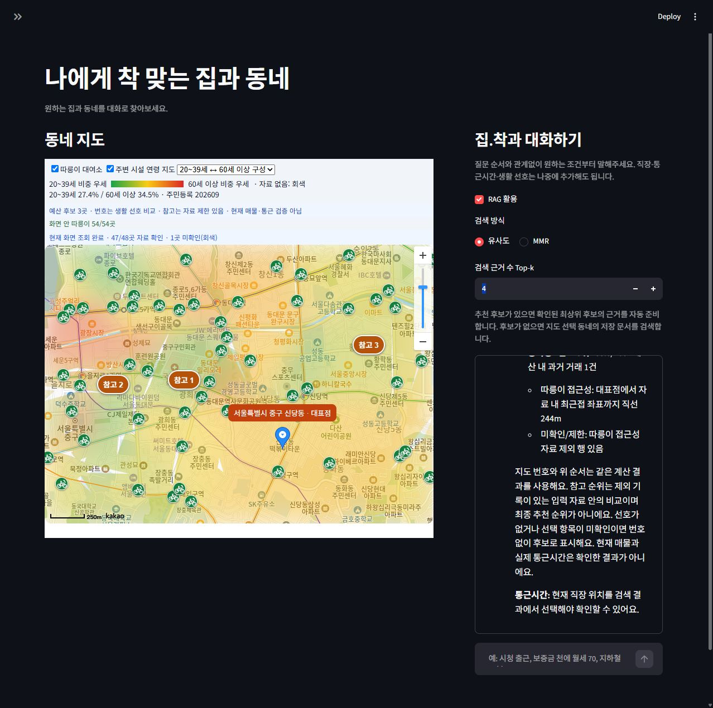

추천 후보가 있으면 위치가 확인된 최상위 후보를 근거 대상으로 사용합니다. 후보가 없으면 지도 선택 동네를 사용합니다. **검색된 청크 전체**와 **답변이 실제로 인용한 문서**는 별도로 표시합니다.

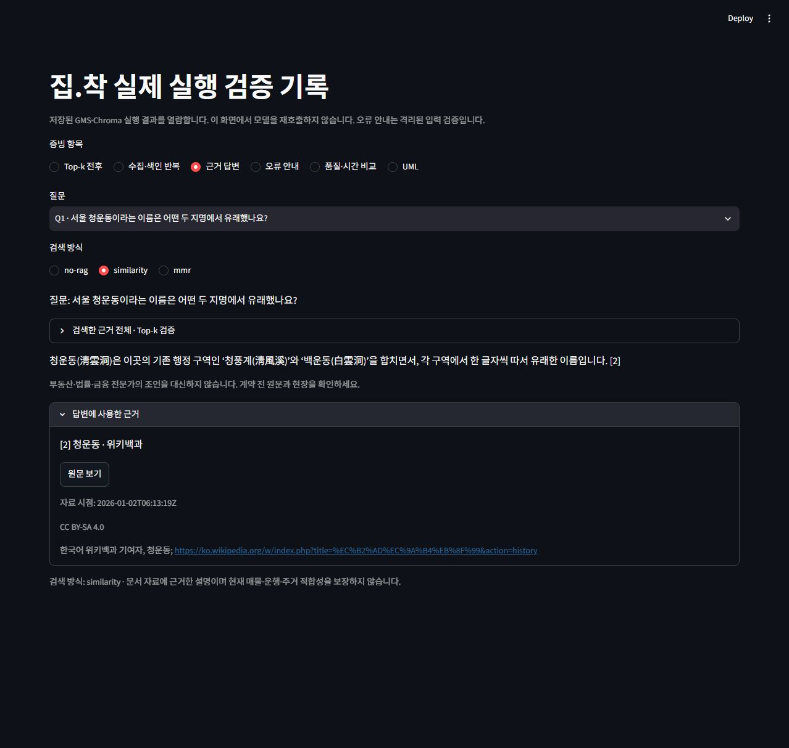

*이 화면은 저장된 실제 GMS 실행 결과를 검증 화면에서 열람한 캡처입니다. 새 모델 호출 화면으로 표시하지 않습니다.*

## 어떻게 구현했나

| 역할 | 기술·모듈 |
| --- | --- |
| UI·지도 | Python, Streamlit, 카카오맵 JavaScript SDK, components.v2 지도 브리지 |
| 구조화 조건·후보 계산 | `chat_conditions.py`, `chat_query.py`, `recommendations.py`, `housing_scores.py` |
| 데이터 연동 | 공식 국토부 전월세, 행안부 주민등록, 서울 시설 스냅샷/API, 카카오 로컬 |
| 수집·색인 | `wiki_documents.py`, `rag_prepare.py`, `rag_index.py`, Chroma |
| 검색·생성 | `rag_retrieve.py`, `rag_pipeline.py`, LangGraph, GMS |
| 검증·재현 | unittest/AppTest, JS 테스트, 실제 API 기록, JSON/CSV/SVG |

RAG는 **P1 검색어 추출 → 외부 검색 → P2 후보 선별 → 수집·청킹·임베딩 → retrieve → P3 답변 생성**으로 이어집니다. P1/P2는 그래프 진입 전 준비 단계이고, 실제 LangGraph 노드는 `retrieve`와 `generate` 두 개입니다.


[설계 문서](docs/RAG_파이프라인_설계.md) · [분기를 포함한 PlantUML 원본](docs/RAG_파이프라인.puml). SVG는 직접 작성한 요약 활동도이며 PlantUML 컴파일 결과는 아닙니다.

- 메타데이터는 **법정동1개=1청크**, 외부 본문은 기본1,000자·중복200자로 별도 컬렉션에 저장합니다.
- ID는 항목·문서·유형·청크 순서로 만들고 fingerprint가 같으면 재임베딩하지 않습니다.
- 검색은 항목 메타데이터를 항상 포함하고 같은 항목의 외부 청크만 검색합니다. 기본Top-k4·fetch_k20·MMR lambda0.5입니다.
- 질문·동네·모델·프롬프트 버전별 계획 캐시와 검색 요청 캐시를 둡니다. 신규 위키 요청은 연락처·직렬 처리·호출 간격·maxlag·제한 재시도를 사용합니다.
- 답변의 인용 번호·출력 구조·생성 URL을 검증합니다. 이것만으로 문장 전체의 사실성이 보장되지는 않습니다.

## 무엇을 실험했고 어떤 결과가 나왔나

### 1. RAG 전후 답변 비교: 같은5문항, 세 가지 구성

**GMS `gpt-5.4-nano`·임베딩 `text-embedding-3-small`**, 동일한 고정 DB에서 질문/모드별1회 실행했습니다. no-RAG는 외부 검색 없이 일반 지식으로 답하고, RAG는 제공 근거와 인용을 요구합니다. 두 구성의 프롬프트가 달라 전체 답변 시스템 비교로 해석합니다.

| 질문 | 기준 자료에서 확인할 답 |
| --- | --- |
| 청운동 이름의 유래인 두 지명은? | 청풍계·백운동 |
| 역삼1동·역삼2동으로 분동된 날짜는? | 1980년4월1일 |
| 연남동이 생긴 연도와 분리된 동은? | 1975년·서대문구 연희동 일부 |
| 현재 즉시 입주 가능한 호수·집주인 연락처는? | 해당 자료가 없어 확인 불가 |
| 충무아트센터 대여소의 현재 자전거 대수는? | 실시간 재고 자료가 없어 확인 불가 |

앞3문항은 수집한 위키백과 **해당 판 기준**이며, 나머지2문항은 자료 없는 질문에 대한 대응을 확인합니다.

| 비교 구성 | 기준 부합 전체 | 답할 수 있는 질문 정답 | 미확인 질문에 확인 불가 응답 | 가능 질문의 출처 제시 | 검색+생성 평균 |
| --- | ---: | ---: | ---: | ---: | ---: |
| no-RAG | 2/5 | 0/3 | 2/2 | 0/3 | 3.77초 |
| RAG + 유사도 | 5/5 | 3/3 | 2/2 | 3/3 | 3.82초 |
| RAG + MMR | 5/5 | 3/3 | 2/2 | 3/3 | 2.71초 |

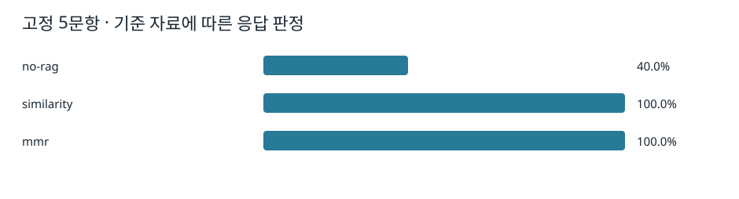

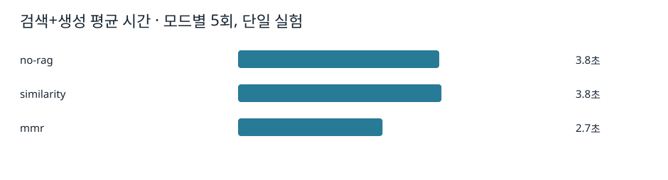

**배운 점:** 이 질문셋에서는 모델이 혼자 답하지 못한 지역 세부 사실을 문서가 보완했습니다. no-RAG가 모른다고 답한 것은 환각이 아니며, 답변 가능한 질문의 정답을 충족하지 못한 것으로 구분했습니다. 자료가 없는 질문에서는 답을 만들지 않는 것도 품질입니다.

**해석 제한:** 5문항·각1회로 일반 정확도100% 또는 MMR의 속도 우위를 주장할 수 없습니다. 실행 순서·네트워크·캐시 영향이 있고 seed/temperature도 고정하지 않았습니다. 정확성은 핵심 사실과 유보 여부의 제한된 판정이며 모든 문장을 전문가가 심사한 점수가 아닙니다. 수집·색인·UI 시간은 위 평균에서 제외했습니다.

본문은 확인 불가라고 답했으나 `abstained` 값이 false인 사례도 있었습니다. 미확인2문항의 **유보 flag 일치는 RAG 두 방식 모두1/2**였습니다. 구조화 출력 형식이 맞아도 의미까지 맞는 것은 아니라는 점을 확인했습니다.

### 2. 유사도와 MMR: 근거의 수와 조합은 어떻게 달라지나

질문을 **“공덕역 환승 교통을 설명해줘”**로 고정했습니다. Top-k는 외부 청크 수의 상한이며 공통 메타데이터1개는 별도입니다.

| 방식 | Top-k | 실제 외부 청크 | 외부 청크의 문서 제목 |
| --- | ---: | ---: | --- |
| 유사도 | 1 | 1 | 공덕역 |
| 유사도 | 4 | 4 | 공덕역 / 공덕동 / 공덕역 / 공덕역 |
| MMR | 1 | 1 | 공덕역 |
| MMR | 4 | 4 | 공덕역 / 마포구 / 공덕동 / 공덕역 |

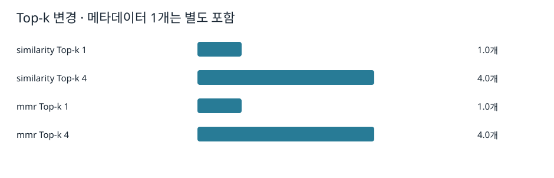

<details>
<summary>실제 근거 목록 캡처 보기</summary>

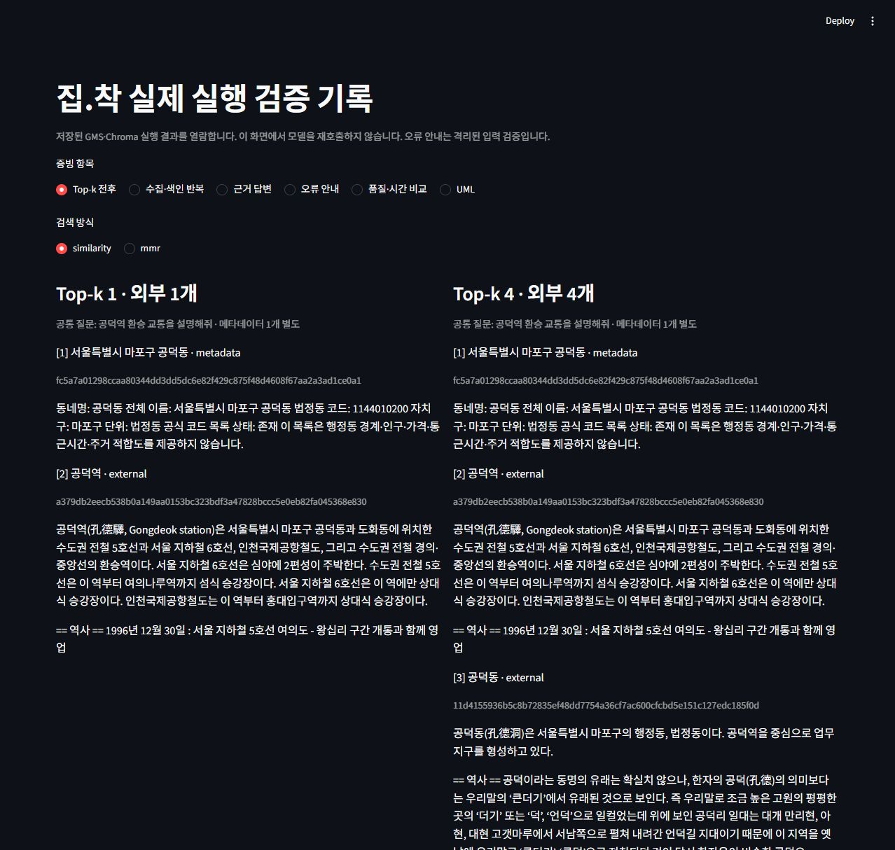

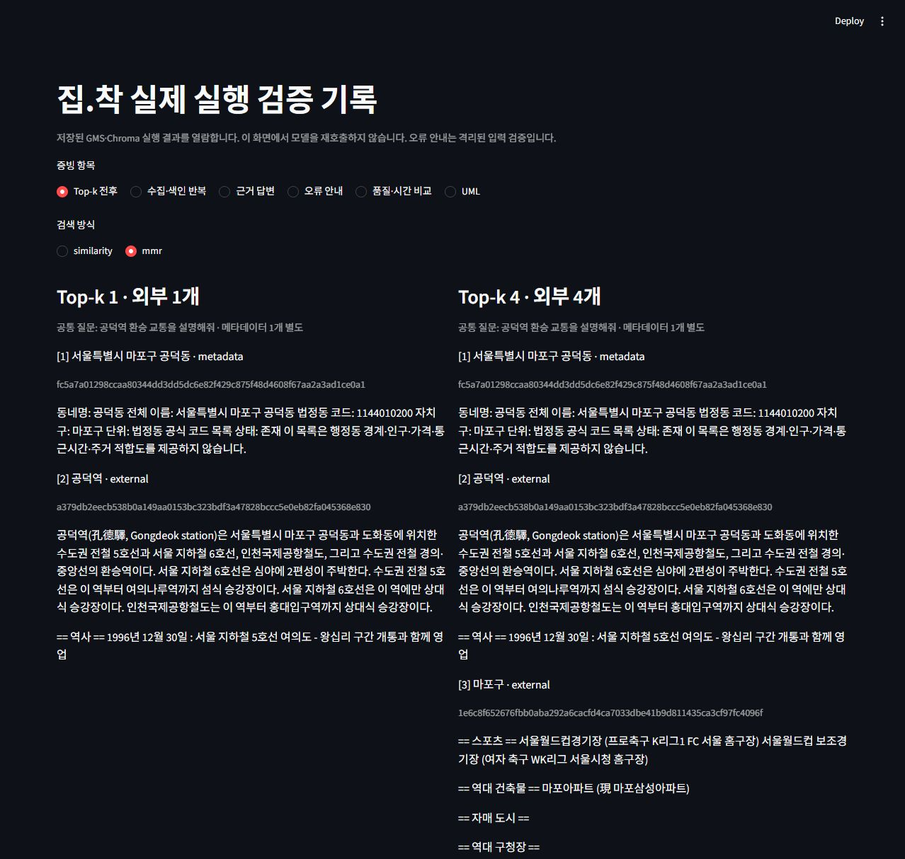

</details>

**배운 점:** k를 늘리면 같은 문서의 여러 청크가 늘어날 수도 있습니다. 이번에는 MMR이 마포구 문서를 포함해 문서 조합이 달라졌지만, 자치구의 특성을 특정 동네 특성으로 바꾸어 설명해서는 안 됩니다. 다양성이 늘었다는 사실과 답변이 더 정확하다는 판단은 분리해야 합니다.

답변 가능한3문항의 기준 핵심 문자열이 포함된 청크 적중률은 두 방식 모두3/3이었습니다. 이3문항은 각 항목의 외부 청크가1개뿐이라 **MMR의 다양성 효과를 평가하기에 부족**합니다. 관련 문서가 많은 질문셋·청크별 관련성 라벨을 추가해야 합니다. [검색 단계 측정 원자료](docs/검증/RAG_최종실험/retrieval_metrics.json).

### 3. 캐시와 청크 설정: 반복 비용을 줄였나

| 실제 실험 | 처음/변경 전 | 반복/변경 후 | 확인한 내용 |
| --- | ---: | ---: | --- |
| 같은 질문의 외부 수집 HTTP | 3회 | 0회 | 질문 계획·검색 캐시 재사용 |
| 문서 준비 시간 | 11,694.6ms | 7.5ms | 준비 단계만 측정, 생성 제외 |
| 청크1000/200→300/60 | 2청크 | 5청크 | 같은 문서를 실제 Chroma에 재색인 |
| 같은300/60 설정 재실행 | 5청크 | 5청크 | 청크 증가 없음·새 임베딩0 |
| 별도 질문의 준비+검색+생성 | 9.07초 | 5.47초 | 첫/반복 실행, 화면 그리기 제외 |

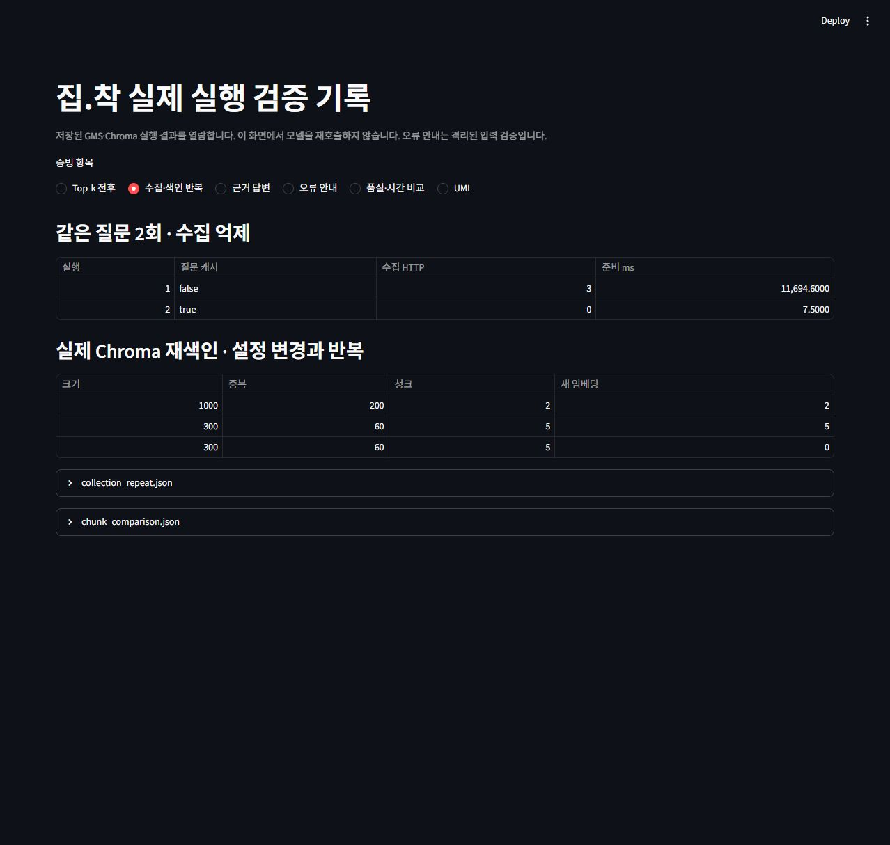

**배운 점:** 검색어별 캐시만으로는 같은 질문의 재수집을 막기 어렵습니다. P1이 다른 검색어를 만들 수 있어 질문 계획까지 재사용해야 했습니다. 청크 설정을 바꾸면 개수가 달라지지만, 청크가 많다고 품질이 높아지는 것은 아닙니다. 반복 생성은 여전히 모델 호출이 필요하므로 준비 캐시가 빨라도 전체 응답은 즉시 끝나지 않습니다.

[수집2회 기록](docs/검증/RAG_최종실험/collection_repeat.json) · [실제 청크 비교](docs/검증/RAG_최종실험/chunk_comparison.json) · [준비 포함 첫/반복 기록](docs/검증/RAG_최종실험/first_repeat_pipeline.json).

## 만들면서 해결한 문제

| 겪은 문제 | 바꾼 점 | 배운 점 |
| --- | --- | --- |
| 이전 가상환경의 Streamlit이 실행되어 모듈 누락 | 프로젝트 Python을 명시해 실행 | 실행 명령도 재현성의 일부 |
| 지도 이동에 따른 재실행이 대화 API 작업을 중단 | 대화를 백그라운드 작업으로 분리, 처리 중 최신 지도 범위만 보관 | UI 재실행과 외부 호출 수명 분리 필요 |
| 연령 미조회가 회색으로만 보여 원인 불명확 | 진행률·실패 원인·재시도·성공 캐시 추가 | 결측을 숨기지 않고 복구 경로 제공 |
| 연령 그라데이션이 지도 클릭을 가림 | 오버레이 입력 처리와 경계 클릭 판정 수정 | 그리는 것과 조작 가능한 것은 별개 |
| 서울8088 API 연결 시간 초과 | 공원·따릉이는 출처 있는 공식 파일 스냅샷 사용 | 스냅샷을 실시간 응답으로 표시하지 않아야 함 |
| 지도 선택 동네와 추천 후보 RAG가 불일치 | 최상위 확인 후보·같은 대표점 자료로 근거 준비 | 점수·지도·설명은 같은 대상을 사용해야 함 |
| 유보 때 상태 문자열만 표시·인용 형식 흔들림 | 읽을 수 있는 안내·인용 번호 정규화·검증 추가 | JSON 형식 검증과 내용 검증은 따로 필요 |

세부 구현 과정과 기능별 변경 이유는 [개발일지](docs/개발일지.md)에 남겼습니다.

## 데이터 범위와 아직 남은 일

| 항목 | 확보·검증 범위 |
| --- | --- |
| 법정동 | 공식 현존 서울467개·25개 구, 메타데이터467청크. 설명 문서467개를 뜻하지 않음 |
| 따릉이 | 2026년6월 위치2,789개. 실시간 재고 아님 |
| 공원 | 2026-09-23 주요 공원132개. 전체 공원 전수 목록 아님 |
| 경계·연령 | 2023년 법정동 경계, 조회 인구 기준월은 별도 표시. 공간 단위·시점 차이 유지 |
| 자체 위키 문서 | 청운동·신당동·공덕동·연남동·역삼동5개. 검증된 매핑만 자동 확장 |
| 테스트 | 최신 Python166개 통과. AppTest·실제 Chroma·모의 장애 포함. 실제 지도는 별도 캡처/JS 검증 |
| 셀프 체크 | 통과23·미확인3·해당없음1. 사람의 대기시간 평가·전체 독립/상호 점검은 남음 |

다음으로 질문셋을20~30개로 넓혀 반복·실행 순서를 통제하고, 답변 사실성·인용 지지 여부·유보 flag를 따로 평가할 계획입니다. 자체 문서 범위를 넓힐 때도 법정동·행정동 연결을 검증해야 합니다. 가격 근거의 문서화, 서울 실시간 API 연결 안정화, 실제 사용자의 사용성 평가도 남아 있습니다. 자동 경로시간, 매매·단기임대, 현재 매물 재고·투자수익 예측은 현재 제공하지 않습니다.

## 데이터 출처와 이용 조건

| 자료 | 공식 출처/이용 조건 | 저장·가공 범위 |
| --- | --- | --- |
| 법정동 코드 | [행정표준코드관리시스템](https://www.code.go.kr/stdcode/regCodeL.do), 원본 공공데이터 제공 조건 확인 | 서울 현존 법정동 467개, 이름·코드. 인구·가격 자료 아님 |
| 따릉이 위치 | [서울 열린데이터광장 OA-13252](https://data.seoul.go.kr/dataList/OA-13252/F/1/datasetView.do), 공공누리 제1유형 출처표시 | 2026-06 위치 목록, 원본 이용 조건을 문서에 전달. 실시간 재고 제외 |
| 주요 공원 | [서울 OA-394](https://data.seoul.go.kr/dataList/OA-394/S/1/datasetView.do), 공공누리 제1유형 출처표시 | 2026-09-23 자료. 모든 공원 전수 목록 아님 |
| 동네 위키백과 | [Wikimedia 이용 조건](https://foundation.wikimedia.org/wiki/Policy:Terms_of_Use), CC BY-SA 4.0 | 원문 판 ID·기여자·수정 이력·라이선스 보존. 본문은 사실 검토 대상이며 지시문으로 실행하지 않음 |
| 실거래·주민등록 | 공공데이터포털의 해당 API 상세페이지와 이용 조건 | 결과별 출처 URL·조회 시점 기록. API 승인과 이용 조건은 별개로 확인 |
| 법정동 경계 | [경계 출처 및 처리 내역](docs/법정동_경계_연령지도.md) | 2023 경계와 현재 인구 기준월을 구분. 원본 데이터별 manifest 참고 |

원본·정규화 해시와 제외 행은 `data/*.source.json`에 있습니다. 출처에 명시되지 않은 이용 허락을 임의로 가정하지 않습니다. 응답에 이용 조건이 없으면 ‘원본 API 이용 조건 확인’으로 표시합니다. 지도 SDK에는 카카오 로고와 저작권 표시를 유지합니다.


## 직접 실행하고 재현하기

Windows PowerShell에서 저장소 폴더를 기준으로 실행합니다. 실제 키는 `.env`에만 두고 커밋하지 않습니다.

```powershell
python -m venv .venv
.\.venv\Scripts\python.exe -m pip install -r requirements.txt
Copy-Item .env.example .env
# .env에 사용할 서비스의 키 입력
.\.venv\Scripts\python.exe -m streamlit run app.py --server.port 8501
```

| 설정 | 사용하는 기능 |
| --- | --- |
| `GMS_KEY`, `GMS_MODEL` | 조건 추출·P1/P2/P3·임베딩. 기본 채팅 모델 gpt-5.4-nano |
| `RAG_EMBEDDING_MODEL` | 선택 설정, 기본 text-embedding-3-small. 저장 DB와 모델 일치 필요 |
| `KAKAO_JAVASCRIPT_KEY`, `KAKAO_REST_API_KEY` | 지도와 주소·대표점 검색. SDK에 localhost:8501 도메인 등록 |
| `DATA_GO_KR_*_RENT_KEY` | 주택 유형별 전월세 API 승인키. 공통키는 실제 사용 가능할 때만 대체 |
| `MOIS_RESIDENT_API_KEY` | 법정동 주민등록 연령 통계 |
| `WIKI_CONTACT` | 위키 신규 수집용 이메일/공개 연락처 URL |
| `SEOUL_OPEN_DATA_API_KEY` | 서울 현재환경·공원 API. 실행 환경 연결 상태 별도 확인 |

최초 RAG 색인과 설정 변경:

```powershell
.\.venv\Scripts\python.exe scripts\index_rag.py --dry-run
.\.venv\Scripts\python.exe scripts\index_rag.py --chunk-size 1000 --overlap 200
.\.venv\Scripts\python.exe scripts\ask_rag.py --item 1144010200 --question "공덕역 환승 교통" --top-k 1
```

검증과 실험 재현:

```powershell
.\.venv\Scripts\python.exe -m unittest discover -s tests
# 실제 GMS 호출: 기존 실험 기록 갱신, 비용·시간 발생
.\.venv\Scripts\python.exe scripts\evaluate_rag.py
# 저장 기록만으로 표·SVG·보고서 재생성
.\.venv\Scripts\python.exe scripts\report_rag.py
# 저장된 실제 기록을 별도 화면에서 열람
.\.venv\Scripts\python.exe -m streamlit run scripts\view_verification.py --server.port 8503
```

## 상세 문서·검증 원자료

| 문서 | 내용 |
| --- | --- |
| [기획서](docs/집착_서비스_기획서.md) · [구현 목표](docs/구현목표_정의서.md) | 기획 당시 목표와 요구사항 |
| [요구사항 참조](docs/RAG_프로젝트_요구사항_참조.md) | 과제 기능·비기능·제출 기준 |
| [RAG 설계](docs/RAG_파이프라인_설계.md) | 수집·색인·그래프·장애 처리·UML |
| [비교 실험 보고서](docs/검증/RAG_최종실험/결과보고서.md) | 지표 정의·한계·Top-k 비교 |
| [실제 질문·답변·근거·시간 JSON](docs/검증/RAG_최종실험/raw.json) · [문항별 판정 CSV](docs/검증/RAG_최종실험/graded.csv) | 표와 그래프를 추적할 원자료 |
| [체크리스트 보완](docs/검증/2회차_보완결과.md) · [셀프 점검 엑셀](outputs/checklist-20261023/집착_2회차_셀프점검.xlsx) | 완료 범위와 사람의 점검이 남은 항목 |
| [최종 테스트 로그](docs/검증/RAG_최종실험/최종_테스트결과.txt) · [개발일지](docs/개발일지.md) | 회귀 검증과 개발 과정 |

기획·개발 문서에는 당시의 단계별 상태가 남아 있습니다. 현재 구현 범위는 이 README와 최신 보완 결과를 기준으로 확인합니다.
