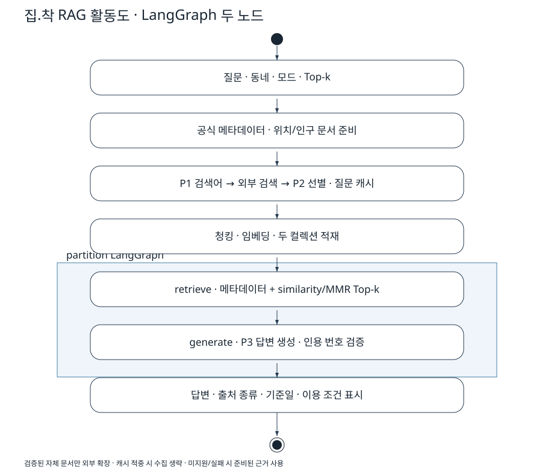

# 집.착 RAG 파이프라인 설계

## 실행 경로

조건 대화는 GMS로 조건을 누적하고 공식 전월세 자료를 코드로 필터링한다. 위치·시설·선호 점수는 결정적 계산이며 LLM이 임의로 예산이나 통근시간을 만들지 않는다. RAG를 켜면 위치가 확인된 최상위 추천 후보를 근거 대상으로 선택한다. 후보가 없으면 지도 선택 동네의 저장 색인을 사용한다.

1. `rag_candidate.py`: 동일 대표점 기준 공식 시설·확인된 주민등록 자료를 출처·기준일·이용 조건과 함께 문서화한다. 자료 묶음 SHA256별 저장 공간을 분리한다.
2. `rag_prepare.py`: 자체 문서 연결이 검증된 동네에서 자체 문서를 우선 적재한다. P1 검색어 추출 → 위키백과 검색 → P2 후보 선별 → 지역 연결 검증 → 본문 수집·색인 순서다. 모든 후보와 선택/제외 사유를 기록한다. 검증되지 않은 동네를 이름만 보고 같은 위키 문서로 연결하지 않는다.
3. 질문·동네·모델·프롬프트 버전을 키로 계획과 실제 문서를 캐시한다. 재질문은 외부 수집 및 P1/P2 호출 없이 문서를 색인에 복구한다. 다른 질문도 동일 검색어는 요청 캐시를 사용한다. 갱신 정책은 수동이며 자동 최신성 보장은 없다.
4. `rag_index.py`: 메타데이터는 항목당 1청크, 외부 본문은 기본1000자/중복200자. CLI `--chunk-size`, `--overlap`으로 조정한다. 항목·문서·유형·청크 번호 기반 ID로 충돌을 피하고 fingerprint가 같은 문서는 재임베딩하지 않는다. 모델 불일치 DB는 거부하고 변경 시 남는 이전 청크를 제거한다.
5. `rag_pipeline.py`: 실제 LangGraph 노드는 **retrieve와 generate 두 개**다. P1/P2는 그래프 진입 전 준비 단계다. 그래프 trace·실제 노드/edge는 실험 raw.json에 저장한다.
6. `rag_retrieve.py`: 항목 메타데이터를 항상 포함하고 같은 항목 외부 후보 중 유사도/MMR로 k개 이하를 고른다. 기본 k=4, fetch_k=20, MMR lambda=.5. 메인·수동 UI에서 k=1~20, CLI `--top-k`로 변경한다. 같은 문서의 여러 청크는 별개 검색 근거이며 인용 목록은 문서 단위로 합친다.
7. P3는 제공 근거에 한정해 답하고 인용 번호를 생성한다. 출력 구조·번호·생성 URL을 검증하고 읽을 수 없는 유보 상태 문자열을 안내로 바꾼다. 이 검증만으로 사실 정확성을 보장하지 않는다. 본문과 abstained flag의 의미 불일치가 실제 실험에 있어 별도 기록한다.

## UI와 장애 처리

메인 화면은 지도와 대화이며 수동 검증은 접힌 사이드바에 둔다. 대화 위에서 RAG·검색 방식·Top-k를 설정한다. 각 응답에 검색된 전체 청크, 실제 인용한 문서, 검색어·선별 기록을 분리해 보여준다. JSON을 저장할 수 있다. 위키백과·서울 공식 시설·공식 통계와 메타데이터를 구분한다.

키 없음과 색인 없음은 별도 안내로 표시하고 외부 연결의 원문 예외는 숨긴다. 준비가 실패해도 조건 추천을 보존하고 기존 근거 범위로 답한다. 자료가 부족하면 유보한다. 계약·법률·금융 전문가의 조언을 대신하지 않는다는 안내를 표시한다. 백그라운드 대화 작업으로 지도 재실행 중 중복 호출·입력 유실을 막고 진행 안내를 표시한다. 대화 처리 시간은 준비·조건 처리·검색·생성을 포함하며 화면 그리기 시간은 제외한다.

## 외부 호출과 이용 조건

위키 HTTP는 프로세스 내부 잠금으로 직렬화하고 호출 후 최소0.2초 간격을 둔다. 연락처 없는 일반 식별자로 새 요청을 보내지 않는다. `WIKI_CONTACT`에는 이메일 또는 공개 연락처 URL을 넣는다. timeout·maxlag·제한 재시도·캐시를 사용한다. GMS는 일시적인 연결/게이트웨이 장애만 제한 재시도한다. 공급처의 권한·쿼터 초과를 우회하지 않는다.

관련 공식 지침: [MediaWiki API 예절](https://www.mediawiki.org/wiki/API:Etiquette), [Wikimedia 호출 제한과 식별 정보](https://www.mediawiki.org/wiki/Wikimedia_APIs/Rate_limits). 전체 서비스의 정책 준수는 해당 공급처 조건도 함께 확인해야 하며, 코드에 호출 간격이 있다는 사실만으로 모든 쿼터 준수를 보장하지 않는다.

위키 판·기여자·CC BY-SA 4.0을 보존하고 시설 스냅샷의 공공누리 이용 조건도 문서로 전달한다. 조건이 명시되지 않은 통계는 임의의 이용 허락을 붙이지 않는다. [README 출처표](../README.md#데이터-출처와-이용-조건)를 참고한다.

## UML와 검증

[PlantUML 원본](RAG_파이프라인.puml)은 조건 분기와 캐시 경로까지 포함한다. SVG는 같은 실행 경로의 요약 활동도로 직접 작성한 벡터이며 PlantUML 컴파일 결과라고 표시하지 않는다. shaded partition에만 실제 LangGraph 두 노드를 둔다.

[5문항 실제 실험·Top-k 전후](검증/RAG_최종실험/결과보고서.md), [보완 결과](검증/2회차_보완결과.md)를 참고한다. 자체 위키 문서 검증 범위는 여전히5개 동네이며 467개 법정동 모두의 자체 설명 문서를 확보했다고 주장하지 않는다. 현재 매물·자동 통근 검증 및 타인의 상호 점검은 이 설계의 완료 범위가 아니다.
